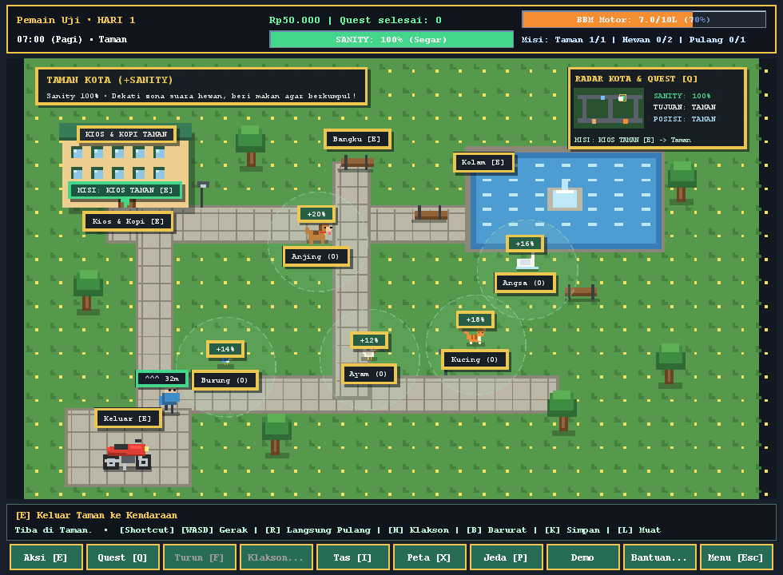
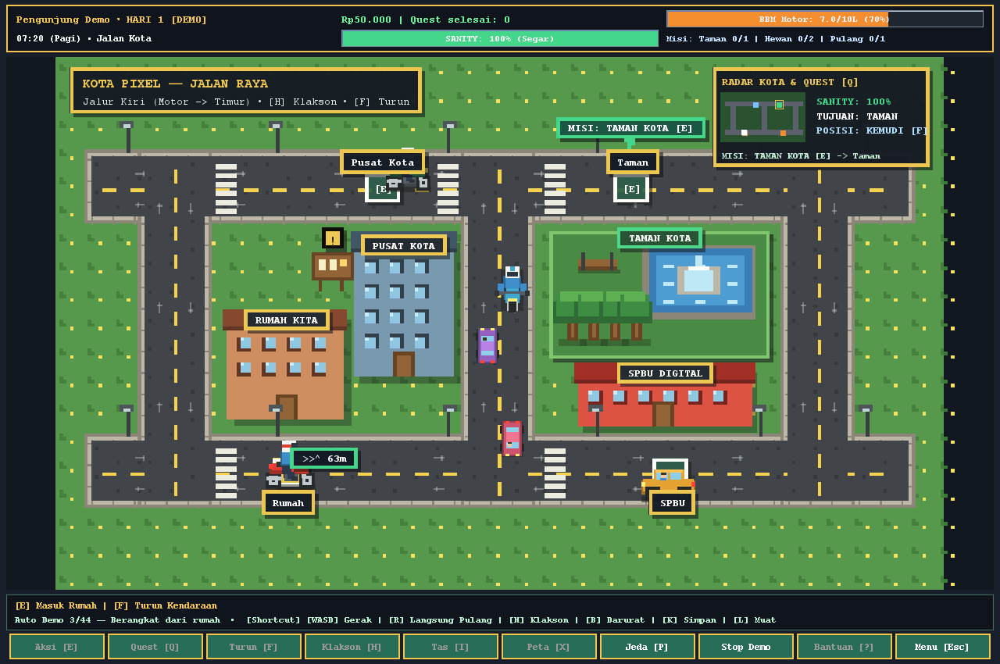
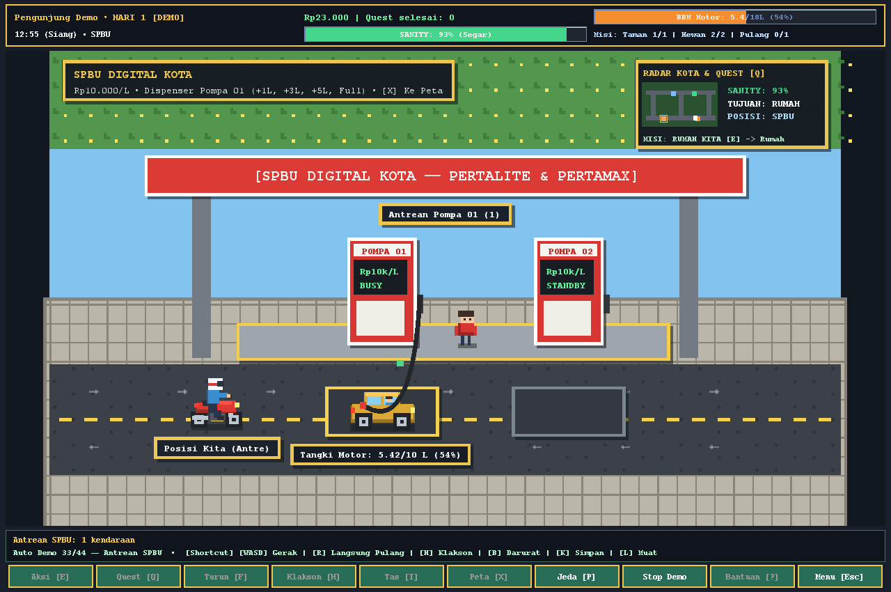

# Hasil pengujian final

Tanggal: 3 Oktober 2026. Lingkungan build: Linux, OpenJDK **17.0.20**, tanpa desktop atau perangkat speaker. Build dari source final memakai `java tools/Build.java --test`. Compiler menggunakan `--release 17`, UTF-8 dan pemeriksaan lint; kompilasi berhasil tanpa error/warning. JAR executable berhasil dibuat.

**233 pemeriksaan otomatis lulus.** Pengujian memuat class gameplay dari JAR hasil build, bukan output `.class` lama. Log lengkap: [BUILD_TEST_LOG.txt](BUILD_TEST_LOG.txt).

| Kelompok pengujian | Hasil yang diperiksa | Status |
| --- | --- | --- |
| Awal/ending/kendaraan | Nama, jam, saldo, inventory kosong, kedua tangki 70%, pilih/lock kendaraan, hasil misi belum lengkap dan hari berikutnya | Lulus |
| Gerak/BBM | Motor 7 px/50 ms, 6 ml per 7 px, diagonal setara lurus, collision jalan/kolam/toko/batas, tidak konsumsi idle/terhalang/pause/dialog/berjalan, nol berhenti, bantuan berbayar/subsidi | Lulus |
| Makanan/hewan | Jumlah/stok/saldo/kapasitas invalid, pembelian atomik, makanan salah dikembalikan, sesuai stok -1, friendship min/max, lima subclass, cooldown, follow nyata, perilaku malam | Lulus |
| Scene/misi/reset | Data bertahan pindah lokasi; dua pemberian pada jenis sama bukan dua jenis; baru berhasil sesudah pulang; reset progres mempertahankan data jangka panjang | Lulus |
| Kota/waktu | Kerja satu kali/hari, tidak membayar ganda, progress/pause, eksplorasi, batas empat periode, pengingat malam sekali dan 23.59 | Lulus |
| SPBU | Antrean 0–3/pause/giliran, saldo terbatas, tangki hampir penuh, nominal nol/negatif/terlalu kecil/besar, quote palsu/lama, klik ganda, commit sekali, cancel dan keluar saat pending | Lulus |
| Event | Distribusi pilihan 70/10/10/10 per kesempatan, cooldown 8 detik, berhenti dua event, macet setengah kecepatan, event berakhir dan guard save | Lulus |
| Save/load | Round-trip semua properti, file hilang/rusak, angka non-finite/di luar batas, enum/boolean invalid, data tidak konsisten, kegagalan IO, temp cleanup, save lama utuh | Lulus |
| Tutup/buka proses | JVM pertama menulis save lalu berhenti; JVM kedua memuat dan memeriksa nilai eksplisit semua data utama | WRITE_OK / READ_OK |
| Auto Demo | 44 tahap, lima scene, misi hari pertama berhasil, Mobil hari kedua, ending kedua belum lengkap, state dan byte save pemain tetap | Lulus; 204,9 detik (±3 menit 25 detik) |
| Input/render/JAR | Key bindings jendela, beberapa tombol, stop/repeat/release, release E dari dialog, GUI arah, satu mouse listener per scene, render minimum/lebih lebar/malam | Lulus |
| Resource/class | Manifest Main-Class, class magic/major 61 (Java 17), 11 PNG dan 5 WAV dari JAR; WAV terdekode menjadi PCM | Lulus |

SHA-256 JAR final: `5f3f7c9d55311e03fabebb8712c5406ecf052a2ac943b9df1106073edd10689d`.

## Bukti render komponen Swing

Screenshot dibuat dari komponen Swing nyata melalui `paint()` dalam mode headless, bukan screenshot sesi desktop interaktif. Pemeriksaan visual mencakup HUD, tombol pada lebar minimum 980 px, peta/objek, sprite berasio asli, scene malam, serta antrean SPBU. Label tombol arah sudah disesuaikan agar tidak terpotong pada ukuran minimum.

## Batas yang belum diverifikasi langsung

- Interaksi jendela desktop Windows, perpindahan fokus ke aplikasi lain, mouse/keyboard fisik dan resize jendela/dialog secara langsung belum diuji. Key bindings, pelepasan tombol modal, pause pada model dan render komponen diuji otomatis; native window MainFrame memerlukan desktop.
- Keluaran audio melalui speaker belum diuji. Semua WAV ditemukan/terdekode dari JAR. Worker audio melaporkan pesan bila perangkat tidak mendukung Clip; audio tidak menghentikan logika game.
- `run.bat`, `run-direct.bat`, `test.bat` dan `run.ps1` disertakan tetapi belum dieksekusi pada Windows. Jalur build offline Java yang dipanggil script berhasil dijalankan pada JDK 17.
- Konfigurasi Maven disediakan tetapi `mvn clean package` belum dijalankan karena Maven tidak tersedia. Build offline tidak memakai Maven atau dependensi eksternal.
- Auto Demo 204,9 detik adalah waktu simulasi dengan tick 50 ms; jeda/dialog atau komputer lambat dapat memperpanjang presentasi.

## Pemeriksaan manual di Windows

1. Ekstrak ZIP lengkap dan jalankan `run-direct.bat` dengan JDK 17+.
2. Mulai Baru, beri nama, pilih Motor, berkendara dengan WASD/panah dan GUI arah. Klik tombol lalu gunakan keyboard kembali. Stop, lepas tombol yang ditahan, lalu lanjut.
3. Buka/tutup interaksi dengan E berulang, uji release E ketika dialog masih terbuka. Ubah ukuran jendela minimum/lebih besar dan resize dialog; periksa tombol serta teks scroll.
4. Beli makanan, beri benar/salah, coba stok kosong dan dengarkan kelima suara. Tutup dialog atau pindah lokasi untuk memastikan audio berhenti.
5. Isi SPBU, cek rincian saldo/tangki, progress dan pembatalan. Pause selama antrean/pengisian lalu lanjut. Coba Bantuan ketika BBM rendah/nol.
6. Save, tutup aplikasi, buka lagi, Muat Save. Cocokkan lokasi, nama, waktu, uang, tas, friendship dan BBM. Simpan cadangan sebelum mencoba file save rusak; permainan aktif harus tetap utuh saat load ditolak.
7. Jalankan Auto Demo sampai akhir atau Stop Demo di tengah. Permainan aktif sebelumnya kembali dan save tidak ditimpa.
8. Selesaikan hari di rumah, lihat hasil sesuai misi, lalu Hari Berikutnya. Jalankan `test.bat` untuk mengulang 233 pemeriksaan di JDK Windows.
